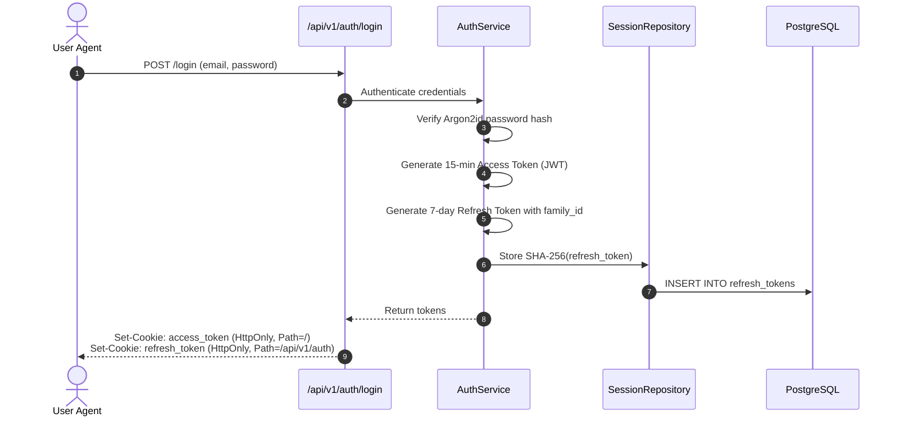
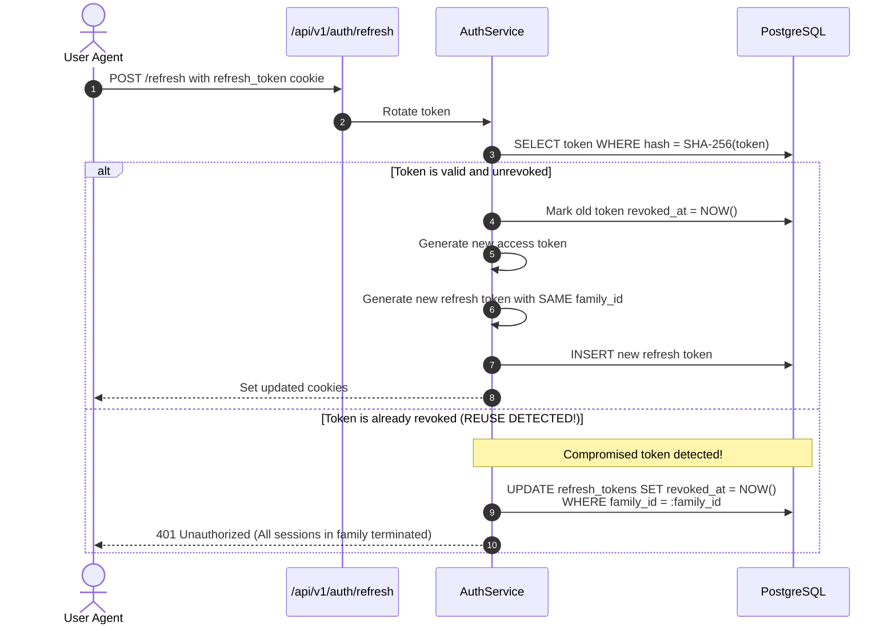

# Authentication and Token Lifecycle — PromptFence

## Overview
PromptFence utilizes a defense-in-depth authentication scheme combining short-lived access JWTs, long-lived refresh tokens stored as cryptographic hashes, token rotation with family tracking, and HttpOnly secure cookies.

## 1. Authentication Flow

## 2. Token Rotation and Reuse Detection

