# Entity Relationship Diagram

> PromptFence — Phase 1 Database Schema

This document contains the Mermaid ER diagram for all 13 Phase 1 tables. Entities are grouped into two logical domains:

- **Authentication & Authorization** — users, roles, permissions, tokens
- **Resources** — targets, test suites, test cases

---

## Full ER Diagram

```mermaid
erDiagram
    %% ─── Authentication & Authorization ───────────────────────────

    users {
        UUID id PK
        VARCHAR email UK "Unique login identifier"
        VARCHAR hashed_password "Argon2id hash"
        VARCHAR full_name
        BOOLEAN is_active "Account enabled flag"
        BOOLEAN is_verified "Email verified flag"
        INTEGER failed_login_attempts "Bad-credential counter"
        TIMESTAMPTZ locked_until "Account lock expiry"
        TIMESTAMPTZ created_at
        TIMESTAMPTZ updated_at
    }

    roles {
        UUID id PK
        VARCHAR name UK "e.g. admin, viewer"
        TEXT description
        BOOLEAN is_system "Seed role — cannot delete"
        TIMESTAMPTZ created_at
    }

    permissions {
        UUID id PK
        VARCHAR resource "e.g. targets, users"
        VARCHAR action "e.g. create, read, delete"
        TEXT description
        TIMESTAMPTZ created_at
    }

    role_permissions {
        UUID role_id PK,FK
        UUID permission_id PK,FK
    }

    user_roles {
        UUID user_id PK,FK
        UUID role_id PK,FK
        UUID assigned_by FK "Admin who assigned"
        TIMESTAMPTZ assigned_at
    }

    refresh_tokens {
        UUID id PK
        UUID user_id FK
        VARCHAR token_hash UK "SHA-256 of raw token"
        TIMESTAMPTZ expires_at
        BOOLEAN is_revoked
        TIMESTAMPTZ created_at
        TIMESTAMPTZ revoked_at
    }

    password_reset_tokens {
        UUID id PK
        UUID user_id FK
        VARCHAR token_hash UK "SHA-256 of raw token"
        TIMESTAMPTZ expires_at
        BOOLEAN is_used
        TIMESTAMPTZ created_at
        TIMESTAMPTZ used_at
    }

    email_verification_tokens {
        UUID id PK
        UUID user_id FK
        VARCHAR token_hash UK "SHA-256 of raw token"
        TIMESTAMPTZ expires_at
        BOOLEAN is_used
        TIMESTAMPTZ created_at
        TIMESTAMPTZ used_at
    }

    %% ─── Resource Entities ────────────────────────────────────────

    targets {
        UUID id PK
        VARCHAR name
        TEXT description
        target_type_enum target_type "OPENAI | ANTHROPIC | CUSTOM_API | LOCAL_MODEL"
        VARCHAR base_url
        UUID owner_id FK
        BOOLEAN is_active
        TIMESTAMPTZ created_at
        TIMESTAMPTZ updated_at
    }

    target_versions {
        UUID id PK
        UUID target_id FK
        VARCHAR version_label "e.g. v1.2"
        VARCHAR model_name "e.g. gpt-4-turbo"
        JSONB config "Temperature, max_tokens, etc."
        TIMESTAMPTZ created_at
    }

    test_suites {
        UUID id PK
        VARCHAR name
        TEXT description
        VARCHAR category "e.g. prompt_injection"
        severity_enum severity_level "LOW | MEDIUM | HIGH | CRITICAL"
        UUID owner_id FK
        BOOLEAN is_public
        TIMESTAMPTZ created_at
        TIMESTAMPTZ updated_at
    }

    test_cases {
        UUID id PK
        VARCHAR name
        TEXT description
        attack_type_enum attack_type "PROMPT_INJECTION | JAILBREAK | ..."
        TEXT prompt_template "Jinja2 attack template"
        TEXT expected_behavior
        severity_enum severity "LOW | MEDIUM | HIGH | CRITICAL"
        UUID owner_id FK
        TIMESTAMPTZ created_at
        TIMESTAMPTZ updated_at
    }

    suite_test_cases {
        UUID suite_id PK,FK
        UUID test_case_id PK,FK
        INTEGER order_index "Execution order (0-based)"
    }

    %% ─── Relationships ───────────────────────────────────────────

    %% Users ↔ Roles (many-to-many via user_roles)
    users ||--o{ user_roles : "has"
    roles ||--o{ user_roles : "assigned to"
    users ||--o{ user_roles : "assigned_by"

    %% Roles ↔ Permissions (many-to-many via role_permissions)
    roles ||--o{ role_permissions : "grants"
    permissions ||--o{ role_permissions : "granted to"

    %% Users → Tokens (one-to-many)
    users ||--o{ refresh_tokens : "owns"
    users ||--o{ password_reset_tokens : "requests"
    users ||--o{ email_verification_tokens : "verifies via"

    %% Users → Targets (one-to-many)
    users ||--o{ targets : "owns"

    %% Targets → Target Versions (one-to-many)
    targets ||--o{ target_versions : "has versions"

    %% Users → Test Suites (one-to-many)
    users ||--o{ test_suites : "owns"

    %% Users → Test Cases (one-to-many)
    users ||--o{ test_cases : "owns"

    %% Test Suites ↔ Test Cases (many-to-many via suite_test_cases)
    test_suites ||--o{ suite_test_cases : "contains"
    test_cases ||--o{ suite_test_cases : "included in"
```



---

## Relationship Summary

### One‑to‑Many

| Parent | Child | Foreign Key | On Delete |
|---|---|---|---|
| `users` | `refresh_tokens` | `refresh_tokens.user_id → users.id` | CASCADE |
| `users` | `password_reset_tokens` | `password_reset_tokens.user_id → users.id` | CASCADE |
| `users` | `email_verification_tokens` | `email_verification_tokens.user_id → users.id` | CASCADE |
| `users` | `targets` | `targets.owner_id → users.id` | CASCADE |
| `users` | `test_suites` | `test_suites.owner_id → users.id` | CASCADE |
| `users` | `test_cases` | `test_cases.owner_id → users.id` | CASCADE |
| `targets` | `target_versions` | `target_versions.target_id → targets.id` | CASCADE |
| `users` | `user_roles` (assigned_by) | `user_roles.assigned_by → users.id` | SET NULL |

### Many‑to‑Many (via Junction Tables)

| Entity A | Junction Table | Entity B | Notes |
|---|---|---|---|
| `users` | `user_roles` | `roles` | Tracks `assigned_by` and `assigned_at` |
| `roles` | `role_permissions` | `permissions` | Pure junction — no extra columns |
| `test_suites` | `suite_test_cases` | `test_cases` | Includes `order_index` for execution order |

---

## Domain Grouping

```
┌─────────────────────────────────────────────────────────────────┐
│                AUTHENTICATION & AUTHORIZATION                   │
│                                                                 │
│  ┌───────┐    ┌────────────┐    ┌─────────────┐                │
│  │ users │◄──►│ user_roles │◄──►│    roles    │                │
│  └───┬───┘    └────────────┘    └──────┬──────┘                │
│      │                                 │                        │
│      │  ┌──────────────────┐   ┌───────┴──────────┐            │
│      ├──┤  refresh_tokens  │   │ role_permissions  │            │
│      │  └──────────────────┘   └───────┬──────────┘            │
│      │  ┌────────────────────────┐     │                        │
│      ├──┤ password_reset_tokens  │  ┌──┴────────────┐          │
│      │  └────────────────────────┘  │  permissions  │          │
│      │  ┌──────────────────────────┐└───────────────┘          │
│      └──┤ email_verification_tokens│                            │
│         └──────────────────────────┘                            │
└─────────────────────────────────────────────────────────────────┘

┌─────────────────────────────────────────────────────────────────┐
│                       RESOURCES                                 │
│                                                                 │
│  ┌─────────┐    ┌──────────────────┐                            │
│  │ targets │───►│ target_versions  │                            │
│  └─────────┘    └──────────────────┘                            │
│                                                                 │
│  ┌─────────────┐    ┌──────────────────┐    ┌────────────┐     │
│  │ test_suites │◄──►│ suite_test_cases │◄──►│ test_cases │     │
│  └─────────────┘    └──────────────────┘    └────────────┘     │
└─────────────────────────────────────────────────────────────────┘
```
